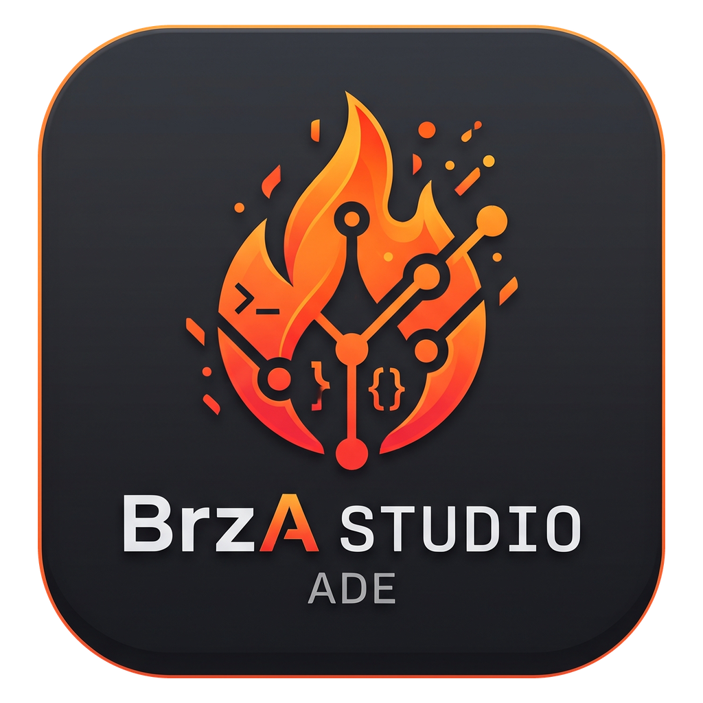

<h1 align="center">
   BrzA Studio
</h1>

<p align="center">
  <strong>ADE — ambiente de desenvolvimento para agentes de IA em paralelo.</strong><br/>
  Rode Claude Code, Codex, OpenCode e outros lado a lado, cada um no seu worktree, acompanhados num só lugar.
</p>

<p align="center">
  
  
</p>

## Requisitos

- Node.js 24
- pnpm 12 (via `corepack`: `corepack enable pnpm`)

## Desenvolvimento

```sh
pnpm install
pnpm dev
```

Antes de entregar uma mudança, rode `pnpm check:changed --maxWorkers=2` (formatação, lint, typecheck, testes afetados e ratchets). Os comandos e as convenções do projeto estão em [AGENTS.md](AGENTS.md) e em [CONTRIBUTING](.github/CONTRIBUTING.md).

## Build local

| Plataforma  | Comando            | Saída                                             |
| ----------- | ------------------ | ------------------------------------------------- |
| Windows x64 | `pnpm build:win`   | `dist/brza-studio-windows-setup.exe`              |
| macOS       | `pnpm build:mac`   | `dist/brza-studio-macos-<arch>.dmg`               |
| Linux       | `pnpm build:linux` | `dist/brza-studio-linux.AppImage`, `.deb`, `.rpm` |

Builds locais não procuram atualizações automáticas.

## Origem e licença

O BrzA Studio é um fork do [Orca](https://github.com/stablyai/orca), distribuído sob a licença MIT. Veja [LICENSE](LICENSE).
